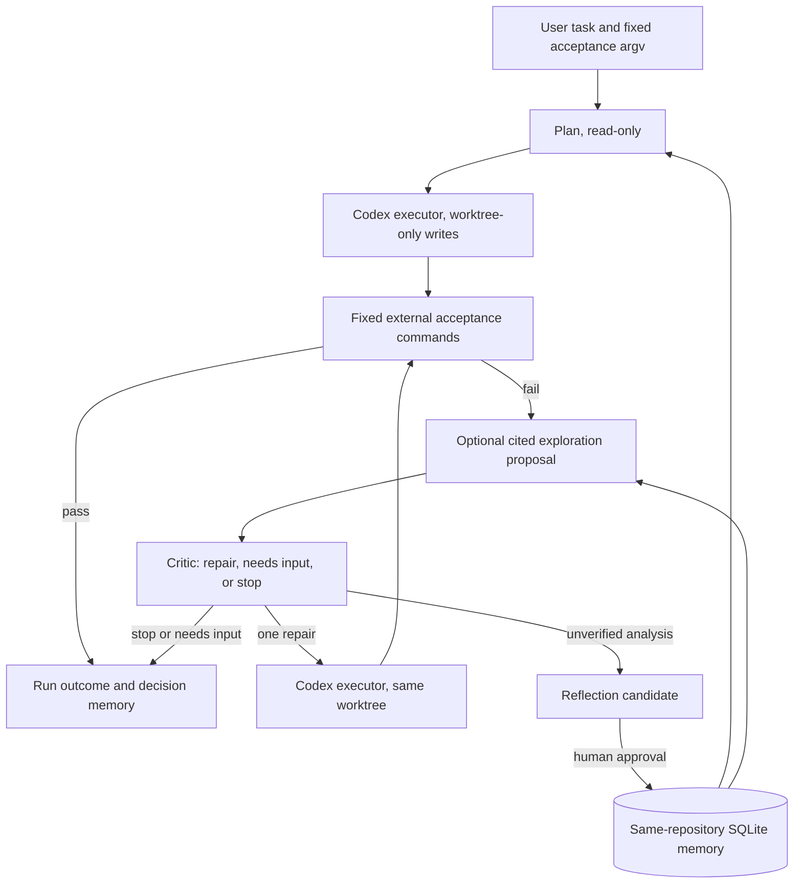

# Architecture and theory boundaries

## Runtime path

`src/runner.ts` owns the task contract and run budget. `src/adapters.ts` executes external programs with `shell: false`, bounded output, timeouts, and cancellation. `src/git.ts` pins the source commit and manages detached worktrees. `src/store.ts` persists events and rebuildable memory/FTS projections. `src/exploration.ts` selects a bounded, less-redundant evidence subset and asks the model for one falsifiable proposal; it never executes it.

Acceptance commands, task objective, base commit, and command permissions are fixed for a run. A model can request user input when it believes the contract must change. The critic does not edit files. The executor can write only in the detached worktree. The run ends with a diff and evidence record; applying the result remains a human action.

## Why these boundaries are plausible

The implementation borrows questions from social theory and pragmatism without turning them into a claim of theoretical completeness:

- **Reflexive sociology:** Bourdieu's account of participant objectivation motivates checking the position and limits of the process that produces an observation. Here, the runtime records its task, prior evidence exposure, generated plan, checks, critique, and outcome so a later user can inspect how a decision was produced. It does not represent social position, field relations, or the agent's inner state. See [Bourdieu, “Participant Objectivation”](https://rai.onlinelibrary.wiley.com/doi/10.1111/1467-9655.00150).
- **Pragmatism:** Dewey's inquiry begins in a problematic situation and tests proposed resolutions against consequences. Here, a failed fixed check supplies a concrete problem; a critic may suggest one repair; the same checks decide whether the repair worked. A passing check is evidence about those commands, not proof of general correctness. See [Dewey, *How We Think*](https://brocku.ca/MeadProject/Dewey/Dewey_1910a/Dewey_1910_a.html).
- **Organizational learning:** March distinguishes exploration from exploitation and describes the risk of over-learning from past success. The optional explorer uses a small MMR-style selection over a capped lexical result set to surface less-redundant evidence. Rank or distance is only a retrieval property; it is not novelty, truth, or value. See [March, “Exploration and Exploitation in Organizational Learning”](https://hiveresearchlab.org/wp-content/uploads/2013/12/march_1991_exploration_and_exploitation_in_organizational_learning.pdf).
- **Public justification:** Boltanski and Thévenot's work is a reminder that claims need reasons that others can contest. This prototype therefore asks for source quotes, applicability conditions, possible refutations, and a minimal validation action. It does not infer consensus or legitimacy. See [Boltanski and Thévenot, “The Sociology of Critical Capacity”](https://doi.org/10.1177/136843199002003010).

These are design prompts, not empirical evidence that the software operationalizes those theories. The architecture deliberately records observable work products and leaves normative decisions with the human owner.

## Memory contract

- Memory is scoped to one repository in this release.
- A decision record links to its run outcome event. Reflection output is a **candidate** and is excluded from retrieval until explicitly approved.
- Approval changes retrieval eligibility; it does not certify that a reflection is true.
- Revisions supersede the prior record and invalidate memories that cite the superseded source. Revoke does the same for the revoked source.
- Search uses SQLite FTS5 when present and a bounded lexical fallback otherwise. It is not semantic search.
- Reopen validation reads the FTS projection once and compares IDs/terms linearly; `memory_id` is not indexed by FTS5, so joining through that column made a 10k-memory reopen take about 25 seconds in the Windows pilot. The linear check reduced the measured mean to 0.58 seconds in that same profile.
- Recorded exposure is not evidence of adoption. The runtime does not claim the model learned from an event.

## Recovery and evaluation evidence

- Events remain the persisted record; memory rows, scopes, FTS entries, and the search cursor are rebuildable projections. The explicit projection-rebuild operation recreates those derived tables in a transaction and replays the event ledger without rewriting events or runs.
- Verification artifacts are separated by round. Each result records the fixed-check hash, base commit, before/after diff hashes, and a summary artifact. The final outcome checks that the worktree still matches the version that was verified.
- The per-run owner record contains the process ID, host name, and start time to help inspect interrupted runs. Artifact hashes and exclusive file creation make accidental overwrites detectable; they do not provide tamper-proof storage.
- PRAXIS_LOOP_STATE_DIR is an isolated test override. Use a fresh study-scoped path in the dedicated VM; do not point a personal runtime at test state.
- Test admission checks are described in the [staged evaluation protocol](EXPERIMENT-PROTOCOL.md). The Windows AppContainer is used only for its documented offline subset; it shares the host kernel and is not a substitute for a disposable VM for full process-runner and model-backed stages.

## Known limits

- One sequential model adapter; no concurrent multi-agent deliberation.
- One repair cycle; no autonomous retry loop.
- Acceptance checks can be incomplete, wrong, or themselves unsafe. The operator supplies and owns them.
- `node:sqlite` is a Release Candidate API in the pinned Node documentation.
- The Codex sandbox is an additional boundary, not a proof of correct behavior. The local event log and model-generated text remain untrusted evidence.
- No deployment, integration with the three original repositories, or real-task effectiveness claim is included in this prototype.
